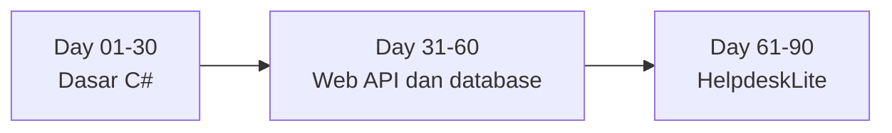

# 90 Days of .NET

[](https://github.com/iqraa07/dotnet-90-days/actions/workflows/build.yml)

Catatan belajar .NET selama 90 hari: dasar C#, pengembangan Web API, dan aplikasi ticketing HelpdeskLite. Kode latihan, jurnal, serta proyek tiap fase berada dalam satu repo.

[Muhammad Iqra Nur Fajar](https://github.com/iqraa07)

[Daftar Day 01-90](days/README.md) · [Peta belajar](#peta-belajar) · [Bukti progres](assets/progress/README.md) · [Day 01](days/day-01/README.md) · [Jurnal](journal) · [Setup](START-HERE.md)

<!-- progress:start -->
**Progress:** 0 / 90 days (0%) · **Current:** Day 01 · **Last update:** 2026-10-24
<!-- progress:end -->

## Peta belajar

Mulai dari [katalog harian](days/README.md). Setiap folder `days/day-NN/` memuat fokus belajar dan tautan yang diperlukan untuk hari tersebut. Rincian praktik ada di [roadmap](ROADMAP.md); kode tetap dikelompokkan berdasarkan fase.



| Fase | Hari | Fokus | Folder |
|---|---|---|---|
| 1 | 01-30 | Dasar C#, OOP, collections, LINQ, async, unit testing | [`phase-1-csharp`](phase-1-csharp) |
| 2 | 31-60 | ASP.NET Core Web API, EF Core, SQL Server, autentikasi, Docker, CI | [`phase-2-webapi`](phase-2-webapi) |
| 3 | 61-90 | HelpdeskLite: aplikasi ticketing dengan API dan Blazor | [`phase-3-capstone`](phase-3-capstone) |

## Teknologi

C# 14 · .NET 10 (LTS) · ASP.NET Core · Entity Framework Core · SQL Server · xUnit · Blazor · Docker · GitHub Actions

## Jalankan Day 01

Gunakan .NET SDK 10.0.x. Dari root repo, jalankan:

```powershell
dotnet --version
dotnet build .\phase-1-csharp\day-01-setup-net-10-and-hello-world
dotnet run --project .\phase-1-csharp\day-01-setup-net-10-and-hello-world
.\day status
```

Day 01 menampilkan nama, tanggal saat program dijalankan, dan versi runtime .NET. Buka [halaman Day 01](days/day-01/README.md) untuk materi dan petunjuk menjalankan. [Jurnal Day 01](journal/day-01-setup-net-10-and-hello-world.md) masih menunggu refleksi pribadi.

## Bukti progres

Hasil build dan run Day 01 sudah terverifikasi. Gambar, output terminal, serta tautan CI tersedia pada [halaman bukti progres](assets/progress/README.md).


## Progres harian

⬜ belum mulai · 🟡 sedang dikerjakan · ✅ selesai · ⏭️ dilewati

Nomor hari mengikuti sesi belajar. Sebuah hari dinyatakan selesai setelah kode lolos build, hasil run diperiksa, dan jurnal terisi. Commit harian memakai format `day-NN: ...` sesuai perubahan yang dikerjakan.

<details>
<summary>Lihat progres 90 hari</summary>

| Day | Topic | Phase | Status | Date | Journal |
|---|---|---|---|---|---|
| 01 | Setup .NET 10 and Hello World | 1 | 🟡 | 2026-10-24 | [journal](journal/day-01-setup-net-10-and-hello-world.md) |
| 02 | Variables and Data Types | 1 | ⬜ | - | - |
| 03 | Operators and Strings | 1 | ⬜ | - | - |
| 04 | Conditionals and Switch | 1 | ⬜ | - | - |
| 05 | Loops | 1 | ⬜ | - | - |
| 06 | Arrays and List | 1 | ⬜ | - | - |
| 07 | Checkpoint 1: To-Do Console App | 1 | ⬜ | - | - |
| 08 | Methods | 1 | ⬜ | - | - |
| 09 | Debugging and Exceptions | 1 | ⬜ | - | - |
| 10 | Classes and Objects | 1 | ⬜ | - | - |
| 11 | Encapsulation and Records | 1 | ⬜ | - | - |
| 12 | Inheritance and Polymorphism | 1 | ⬜ | - | - |
| 13 | Interfaces | 1 | ⬜ | - | - |
| 14 | Checkpoint 2: IT Asset Inventory Console | 1 | ⬜ | - | - |
| 15 | Dictionary, HashSet, Queue, Stack | 1 | ⬜ | - | - |
| 16 | Enums, Structs and Nullable | 1 | ⬜ | - | - |
| 17 | LINQ Part 1 | 1 | ⬜ | - | - |
| 18 | LINQ Part 2 | 1 | ⬜ | - | - |
| 19 | File I/O and CSV | 1 | ⬜ | - | - |
| 20 | JSON with System.Text.Json | 1 | ⬜ | - | - |
| 21 | Checkpoint 3: Inventory with JSON and Reports | 1 | ⬜ | - | - |
| 22 | Advanced Exceptions | 1 | ⬜ | - | - |
| 23 | Generics | 1 | ⬜ | - | - |
| 24 | Delegates, Lambdas and Events | 1 | ⬜ | - | - |
| 25 | Async, Await and HttpClient | 1 | ⬜ | - | - |
| 26 | Mini Tool: Network Checker | 1 | ⬜ | - | - |
| 27 | Unit Testing with xUnit | 1 | ⬜ | - | - |
| 28 | Git and GitHub in Depth | 1 | ⬜ | - | - |
| 29 | Phase 1 Project: Helpdesk Console (Part 1) | 1 | ⬜ | - | - |
| 30 | Phase 1 Project: Helpdesk Console (Part 2) and Review | 1 | ⬜ | - | - |
| 31 | HTTP, REST and First Web API | 2 | ⬜ | - | - |
| 32 | Controllers and Routing | 2 | ⬜ | - | - |
| 33 | CRUD In-Memory | 2 | ⬜ | - | - |
| 34 | DTOs and Validation | 2 | ⬜ | - | - |
| 35 | Dependency Injection | 2 | ⬜ | - | - |
| 36 | Configuration, Logging and Options | 2 | ⬜ | - | - |
| 37 | Checkpoint 4: Error Handling and API Testing | 2 | ⬜ | - | - |
| 38 | SQL Basics | 2 | ⬜ | - | - |
| 39 | SQL Joins and Aggregates | 2 | ⬜ | - | - |
| 40 | EF Core Introduction | 2 | ⬜ | - | - |
| 41 | EF Core CRUD | 2 | ⬜ | - | - |
| 42 | Relationships | 2 | ⬜ | - | - |
| 43 | Migrations and Fluent API | 2 | ⬜ | - | - |
| 44 | Checkpoint 5: Search, Filter, Paging, Sorting | 2 | ⬜ | - | - |
| 45 | Layered Architecture | 2 | ⬜ | - | - |
| 46 | Service Layer and Mapping | 2 | ⬜ | - | - |
| 47 | Logging with Serilog and Global Errors | 2 | ⬜ | - | - |
| 48 | Authentication with JWT | 2 | ⬜ | - | - |
| 49 | Authorization with Roles and Policies | 2 | ⬜ | - | - |
| 50 | Unit Testing Services | 2 | ⬜ | - | - |
| 51 | Integration Testing | 2 | ⬜ | - | - |
| 52 | Export CSV Report | 2 | ⬜ | - | - |
| 53 | Caching and Performance | 2 | ⬜ | - | - |
| 54 | Docker | 2 | ⬜ | - | - |
| 55 | CI with GitHub Actions | 2 | ⬜ | - | - |
| 56 | Deploy to the Cloud | 2 | ⬜ | - | - |
| 57 | Health Checks and Rate Limiting | 2 | ⬜ | - | - |
| 58 | API Documentation | 2 | ⬜ | - | - |
| 59 | Code Review and Refactor | 2 | ⬜ | - | - |
| 60 | Phase 2 Review and Release v0.2 | 2 | ⬜ | - | - |
| 61 | Requirements and Design | 3 | ⬜ | - | - |
| 62 | Solution Scaffold | 3 | ⬜ | - | - |
| 63 | Domain Model and Ticket Workflow | 3 | ⬜ | - | - |
| 64 | Database and Migrations | 3 | ⬜ | - | - |
| 65 | Ticket CRUD Endpoints | 3 | ⬜ | - | - |
| 66 | Comments and Activity Log | 3 | ⬜ | - | - |
| 67 | Checkpoint 6: Core Tests | 3 | ⬜ | - | - |
| 68 | Auth and Roles | 3 | ⬜ | - | - |
| 69 | Ticket Assignment | 3 | ⬜ | - | - |
| 70 | SLA and Background Service | 3 | ⬜ | - | - |
| 71 | Search, Filter and Paging | 3 | ⬜ | - | - |
| 72 | Dashboard Statistics | 3 | ⬜ | - | - |
| 73 | Notifications | 3 | ⬜ | - | - |
| 74 | Checkpoint 7: Integration Tests | 3 | ⬜ | - | - |
| 75 | Blazor Introduction | 3 | ⬜ | - | - |
| 76 | Ticket List Page | 3 | ⬜ | - | - |
| 77 | Create and Edit Forms | 3 | ⬜ | - | - |
| 78 | Login and Auth State in Blazor | 3 | ⬜ | - | - |
| 79 | Dashboard Page | 3 | ⬜ | - | - |
| 80 | UI Polish | 3 | ⬜ | - | - |
| 81 | Checkpoint 8: End-to-End Manual Testing | 3 | ⬜ | - | - |
| 82 | Attachments | 3 | ⬜ | - | - |
| 83 | Logging and Health Checks | 3 | ⬜ | - | - |
| 84 | Docker Compose Full Stack | 3 | ⬜ | - | - |
| 85 | CI/CD Pipeline | 3 | ⬜ | - | - |
| 86 | Deploy and Demo Data | 3 | ⬜ | - | - |
| 87 | Security Review | 3 | ⬜ | - | - |
| 88 | Documentation and Screenshots | 3 | ⬜ | - | - |
| 89 | CV, LinkedIn and GitHub Profile | 3 | ⬜ | - | - |
| 90 | Retrospective and Release v1.0 | 3 | ⬜ | - | - |

</details>

## Struktur repo

```text
days/               katalog dan halaman Day 01-90
journal/            jurnal harian
phase-1-csharp/     latihan console Day 01-30
phase-2-webapi/     proyek Web API Day 31-60
phase-3-capstone/   HelpdeskLite Day 61-90
scripts/day.ps1     helper untuk progres dan commit
templates/          template jurnal dan konfigurasi
docs/               panduan setup, alur harian, dan referensi perintah
```

## Panduan

- [Daftar Day 01-90](days/README.md)
- [Mulai dari setup](START-HERE.md)
- [Rencana 90 hari](ROADMAP.md)
- [Alur kerja harian](docs/02-WORKFLOW-HARIAN.md)
- [Referensi perintah](docs/04-CHEATSHEET.md)
