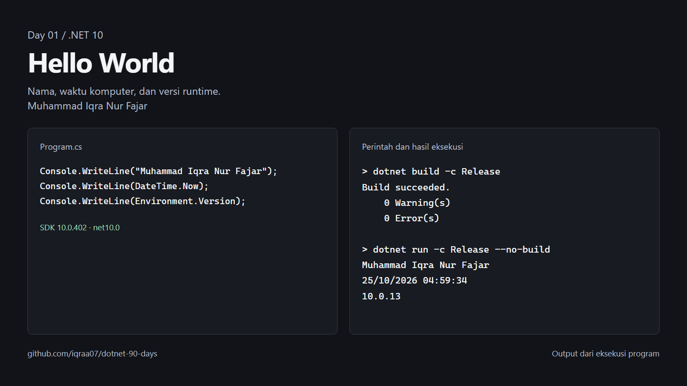
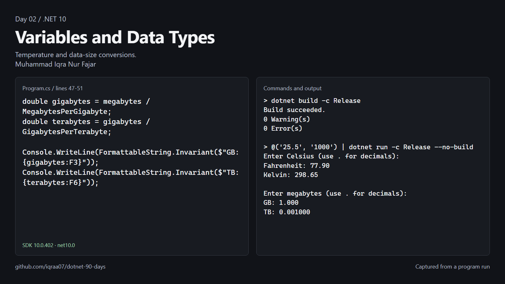
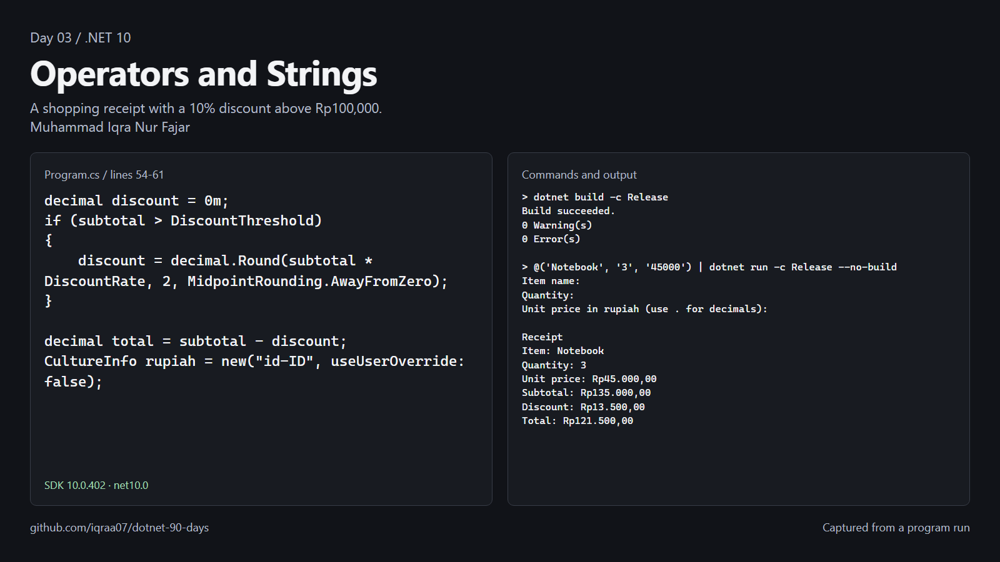

# Progress evidence

Build and execution records for implemented exercises. The [daily progress table](../../README.md#daily-progress) tracks implementation and verification; personal reflection is recorded separately in each journal.

| Day | Verification | Images | Source record | CI |
|---|---|---|---|---|
| [Day 01](../../days/day-01/README.md) | Implementation complete; build and run passed | [Landscape](day-01-terminal.png), [portrait](day-01-social.png) | [Output](day-01-output.txt), [capture data](day-01-capture.json) | [Passed](https://github.com/iqraa07/dotnet-90-days/actions/runs/40132461869) |
| [Day 02](../../days/day-02/README.md) | Build passed; 26 CLI checks | [Landscape](day-02-terminal.png), [portrait](day-02-social.png) | [Output](day-02-output.txt), [capture data](day-02-capture.json), [checks](day-02-checks.txt) | [Passed](https://github.com/iqraa07/dotnet-90-days/actions/runs/43770996823) |
| [Day 03](../../days/day-03/README.md) | Build passed; 39 CLI checks | [Landscape](day-03-terminal.png), [portrait](day-03-social.png) | [Output](day-03-output.txt), [capture data](day-03-capture.json), [checks](day-03-checks.txt) | [Build history](https://github.com/iqraa07/dotnet-90-days/actions/workflows/build.yml) |
| [Day 04](../../days/day-04/README.md) | Release build and CLI checks passed | [Landscape](day-04-terminal.png), [portrait](day-04-social.png) | [Output](day-04-output.txt), [capture data](day-04-capture.json), [checks](day-04-checks.txt) | [Build history](https://github.com/iqraa07/dotnet-90-days/actions/workflows/build.yml) |

## Day 01: Hello World

- Recorded on 25 October 2026, 05:12 WITA (UTC+08:00).
- Release build: 0 warnings and 0 errors.
- Run: exit code 0, printing the owner's name, local time, and runtime version.
- SDK `10.0.402`; runtime `10.0.13`.
- [Verified source](https://github.com/iqraa07/dotnet-90-days/blob/18ea6664a858e88f0e9773f75939d1922f79105e/phase-1-csharp/day-01-setup-net-10-and-hello-world/Program.cs).

[Download the portrait image](day-01-social.png). Implementation is complete. Personal reflection remains pending in the [Day 01 journal](../../journal/day-01-setup-net-10-and-hello-world.md).

## Day 02: Variables and Data Types

The Release build passed with 0 warnings and 0 errors. The example run converted 25.5 °C to 77.90 °F and 298.65 K, and 1000 MB to 1.000 GB and 0.001000 TB. [Read all 26 CLI checks](day-02-checks.txt).

## Day 03: Operators and Strings

Three notebooks at Rp45.000,00 each produced a subtotal of Rp135.000,00, a discount of Rp13.500,00, and a total of Rp121.500,00. [Read the CLI checks](day-03-checks.txt).

## Adding evidence for another day

Save actual execution records as `day-NN-*`, then link them from this index and the daily overview. Include the commands, output, and relevant verification results. Upload evidence with the authorized progress commit to the same repository.
