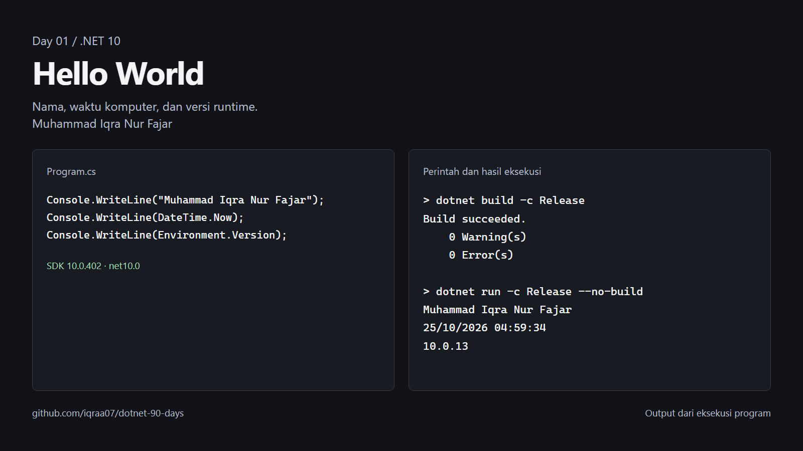

# Day 01: Setup .NET 10 and Hello World

Status: sedang dikerjakan. Kode latihan tersedia; refleksi pribadi pada jurnal belum diisi.

## Fokus

Apa itu .NET, SDK vs runtime, perintah `dotnet new`, `dotnet run`, `dotnet build`; isi file `.csproj` dan `Program.cs`; top-level statements.

## Latihan

Program console menampilkan nama, tanggal saat dijalankan, dan versi runtime .NET.

- [Kode dan petunjuk menjalankan](../../phase-1-csharp/day-01-setup-net-10-and-hello-world/README.md)
- [Jurnal Day 01](../../journal/day-01-setup-net-10-and-hello-world.md)

## Hasil eksekusi



Build Release lulus dengan 0 warning dan 0 error. Program menghasilkan nama, waktu komputer, dan versi runtime, dengan exit code 0.

- [Gambar untuk sosial media, 1080 x 1350](../../assets/progress/day-01-social.png)
- [Catatan perintah dan output](../../assets/progress/day-01-output.txt)
- [Data sumber ekspor](../../assets/progress/day-01-capture.json)

Gambar menata kode dan output dari eksekusi aktual agar mudah dibaca. Untuk membuat ulang dari root repo:

```powershell
.\scripts\export-progress.ps1 -Day 1 -Project 'phase-1-csharp\day-01-setup-net-10-and-hello-world' -Title 'Hello World' -WorkDirectory (Join-Path $env:TEMP 'dotnet-day-01-export')
```

[Materi lengkap](../../ROADMAP.md#day-01--setup-net-10-and-hello-world) · [Progres harian](../../README.md#progres-harian) · [Daftar hari](../README.md)
