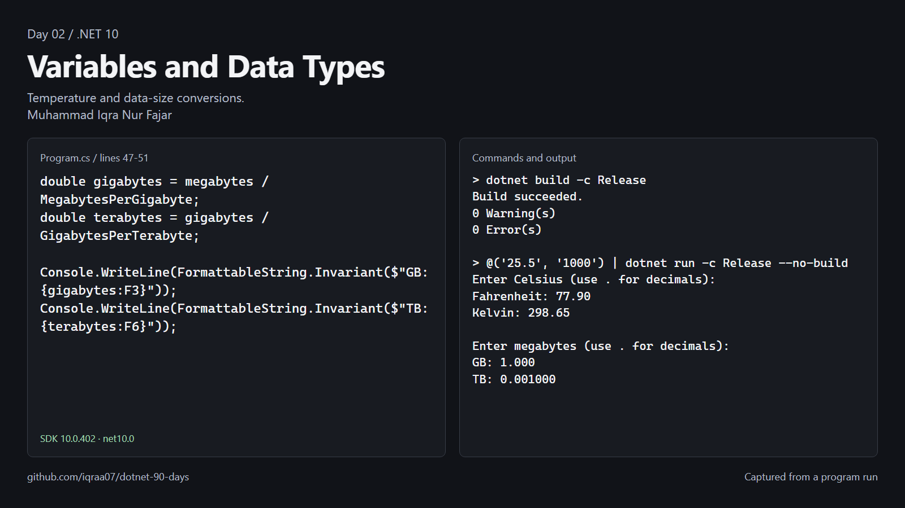

# Day 02: Variables and Data Types

**Implementation:** Complete and verified.

**Personal reflection:** Pending.



[Download portrait image](../../assets/progress/day-02-social.png) · [Run output](../../assets/progress/day-02-output.txt) · [26 verification checks](../../assets/progress/day-02-checks.txt)

## What the program does

Converts Celsius to Fahrenheit and Kelvin, then reads an MB value and displays GB and TB using decimal units. Both inputs use `TryParse`, reject invalid or non-finite values, and display clear results.

## Run

From the repository root:

```powershell
dotnet run --project .\phase-1-csharp\day-02-variables-and-data-types -c Release
```

Enter `25.5`, then `1000`. The expected results are `77.90` Fahrenheit, `298.65` Kelvin, `1.000` GB, and `0.001000` TB.

## Documentation

- [Concepts, conversion rules, and examples](../../phase-1-csharp/day-02-variables-and-data-types/README.md)
- [Learning journal](../../journal/day-02-variables-and-data-types.md)
- [Evidence index](../../assets/progress/README.md#day-02-variables-and-data-types)
- [Captured source, input, and results](../../assets/progress/day-02-capture.json)

Release build passed with 0 warnings and 0 errors. All 26 CLI checks passed. Personal reflection remains separate from the completed implementation.

[Full outline](../../ROADMAP.md#day-02--variables-and-data-types) · [Daily progress](../../README.md#daily-progress) · [Day catalog](../README.md)
