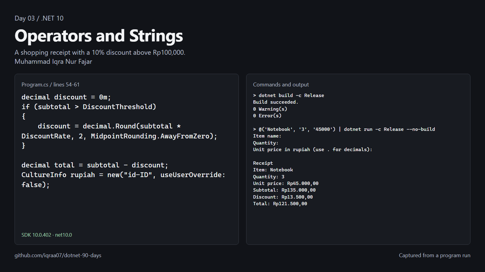

# Day 03: Operators and Strings

The receipt exercise is implemented and verified. Personal reflection is pending in the journal.

The program reads an item name, a quantity, and a unit price. It prints the receipt in Indonesian Rupiah and applies a 10% discount when the subtotal exceeds `Rp100.000,00`.



[Portrait image](../../assets/progress/day-03-social.png) · [Run transcript](../../assets/progress/day-03-output.txt) · [CLI checks](../../assets/progress/day-03-checks.txt)

## Run the example

From the repository root, run this PowerShell command.

```powershell
@('Notebook', '3', '45000') | dotnet run --project .\phase-1-csharp\day-03-operators-and-strings -c Release
```

The subtotal is `Rp135.000,00`, the discount is `Rp13.500,00`, and the total is `Rp121.500,00`.

## Documentation

- [Source, input rules, and C# examples](../../phase-1-csharp/day-03-operators-and-strings/README.md)
- [Learning journal](../../journal/day-03-operators-and-strings.md)
- [Captured source, input, and output](../../assets/progress/day-03-capture.json)

[Full outline](../../ROADMAP.md#day-03--operators-and-strings) · [Daily progress](../../README.md#daily-progress) · [Day catalog](../README.md)
