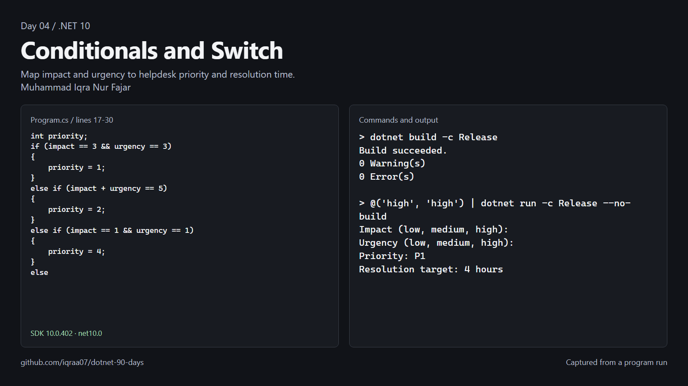

# Day 04: Conditionals and Switch

The program reads an incident's impact and urgency as `low`, `medium`, or `high`. It maps the combination to a priority and uses a switch expression to choose a resolution target.

[Portrait image](../../assets/progress/day-04-social.png) · [Recorded output](../../assets/progress/day-04-output.txt) · [CLI checks](../../assets/progress/day-04-checks.txt) · [Capture data](../../assets/progress/day-04-capture.json)

[Run instructions and explanation](../../phase-1-csharp/day-04-conditionals-and-switch/README.md) · [Journal](../../journal/day-04-conditionals-and-switch.md)

The Release build and 6 CLI checks passed. Personal reflection is pending.

[Full outline](../../ROADMAP.md#day-04--conditionals-and-switch) · [Daily progress](../../README.md#daily-progress) · [Day catalog](../README.md)
