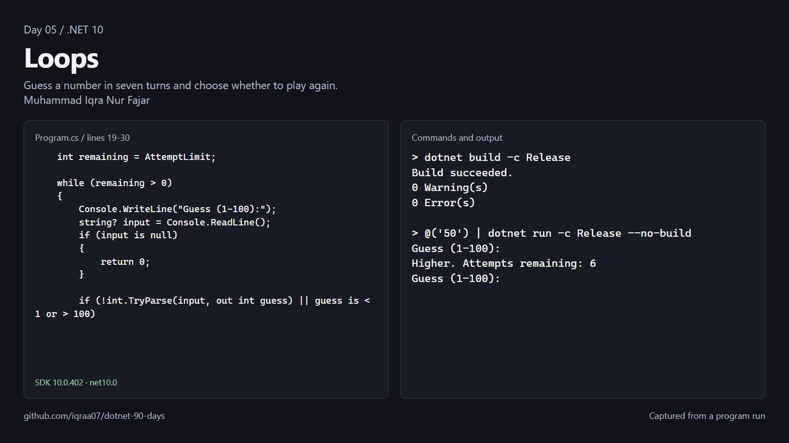

# Day 05: Loops

Guess a number from 1 to 100. Each valid guess uses one of seven attempts. The program reports whether to guess higher or lower and offers another round at the end.

[Portrait image](../../assets/progress/day-05-social.png) · [Recorded output](../../assets/progress/day-05-output.txt) · [CLI checks](../../assets/progress/day-05-checks.txt) · [Capture data](../../assets/progress/day-05-capture.json)

[Run instructions and explanation](../../phase-1-csharp/day-05-loops/README.md) · [Journal](../../journal/day-05-loops.md)

The Release build and 5 CLI checks passed. Personal reflection is pending.

[Full outline](../../ROADMAP.md#day-05--loops) · [Daily progress](../../README.md#daily-progress) · [Day catalog](../README.md)
