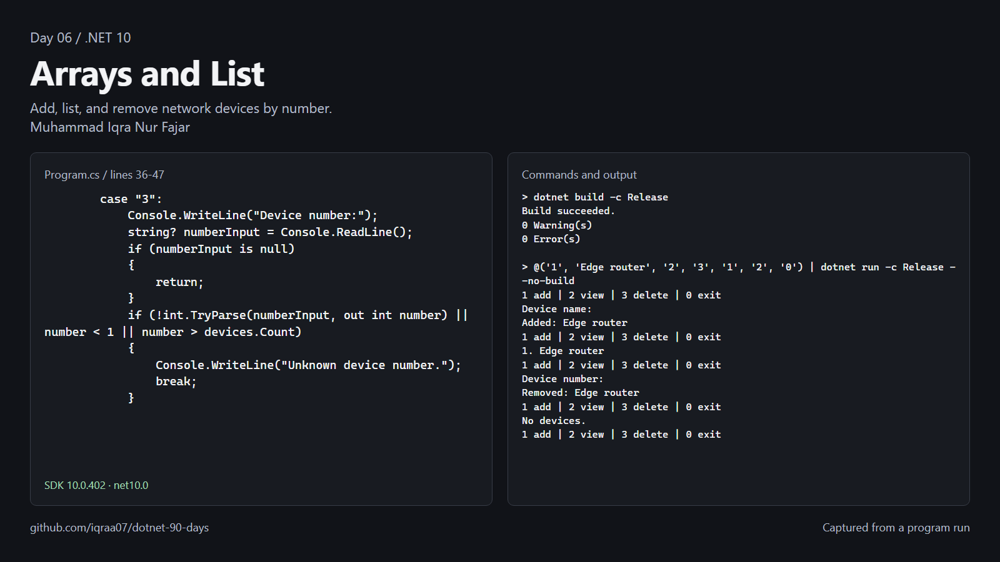

# Day 06: Arrays and List

An in-memory network device list supports add, view, and delete by displayed number. The numbered menu uses a fixed array, while devices belong to a growable `List<string>`.

[Portrait image](../../assets/progress/day-06-social.png) · [Recorded output](../../assets/progress/day-06-output.txt) · [CLI checks](../../assets/progress/day-06-checks.txt) · [Capture data](../../assets/progress/day-06-capture.json)

[Run instructions and explanation](../../phase-1-csharp/day-06-arrays-and-list/README.md) · [Journal](../../journal/day-06-arrays-and-list.md)

The Release build and 4 CLI checks passed. Personal reflection is pending.

[Full outline](../../ROADMAP.md#day-06--arrays-and-list) · [Daily progress](../../README.md#daily-progress) · [Day catalog](../README.md)
