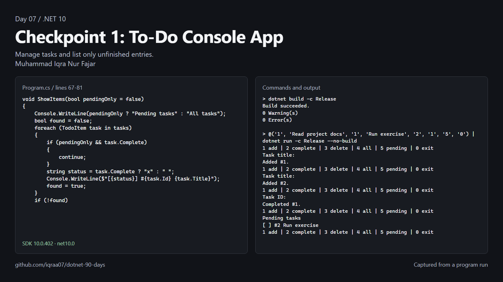

# Day 07: Checkpoint 1: To-Do Console App

This small To-Do app adds, completes, and removes tasks. The same list view can display all tasks or only unfinished ones. IDs stay stable during the session.

[Portrait image](../../assets/progress/day-07-social.png) · [Recorded output](../../assets/progress/day-07-output.txt) · [CLI checks](../../assets/progress/day-07-checks.txt) · [Capture data](../../assets/progress/day-07-capture.json)

[Run instructions and explanation](../../phase-1-csharp/day-07-checkpoint-1-to-do-console-app/README.md) · [Journal](../../journal/day-07-checkpoint-1-to-do-console-app.md)

The Release build and 5 CLI checks passed. Personal reflection is pending.

[Full outline](../../ROADMAP.md#day-07--checkpoint-1-to-do-console-app) · [Daily progress](../../README.md#daily-progress) · [Day catalog](../README.md)
