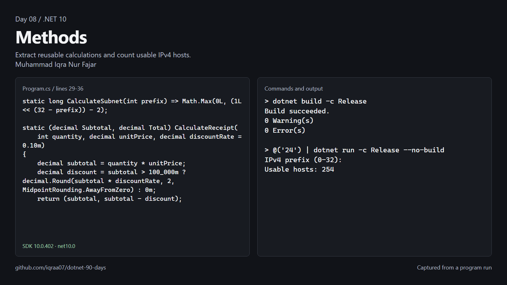

# Day 08: Methods

The default mode accepts an IPv4 prefix and displays the number of usable hosts under the traditional network-and-broadcast rule. Two other modes extract calculation patterns from the Day 02 temperature converter and Day 03 receipt.

[Portrait image](../../assets/progress/day-08-social.png) · [Recorded output](../../assets/progress/day-08-output.txt) · [CLI checks](../../assets/progress/day-08-checks.txt) · [Capture data](../../assets/progress/day-08-capture.json)

[Run instructions and explanation](../../phase-1-csharp/day-08-methods/README.md) · [Journal](../../journal/day-08-methods.md)

The Release build and 10 CLI checks passed. Personal reflection is pending.

[Full outline](../../ROADMAP.md#day-08--methods) · [Daily progress](../../README.md#daily-progress) · [Day catalog](../README.md)
