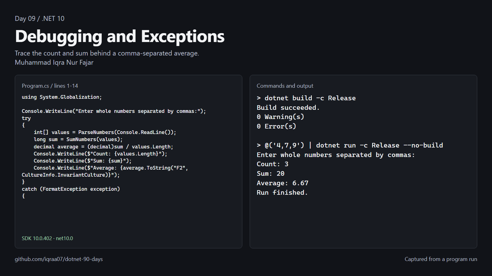

# Day 09: Debugging and Exceptions

Calculate the count, sum, and average of comma-separated integers. Invalid input produces a short diagnostic, and the `finally` block reports the end of each run. The implementation is verified and the personal reflection is pending.



[Portrait image](../../assets/progress/day-09-social.png) · [Run transcript](../../assets/progress/day-09-output.txt) · [Checks](../../assets/progress/day-09-checks.txt)

## Run the example

From the repository root in PowerShell, run:

```powershell
'4,7,9' | dotnet run --project .\phase-1-csharp\day-09-debugging-and-exceptions -c Release
```

`4,7,9` produces a count of `3`, a sum of `20`, and an average of `6.67`.

[Exercise documentation](../../phase-1-csharp/day-09-debugging-and-exceptions/README.md) · [Journal](../../journal/day-09-debugging-and-exceptions.md) · [Captured run](../../assets/progress/day-09-capture.json)

[Roadmap](../../ROADMAP.md#day-09--debugging-and-exceptions) · [Day catalog](../README.md)
