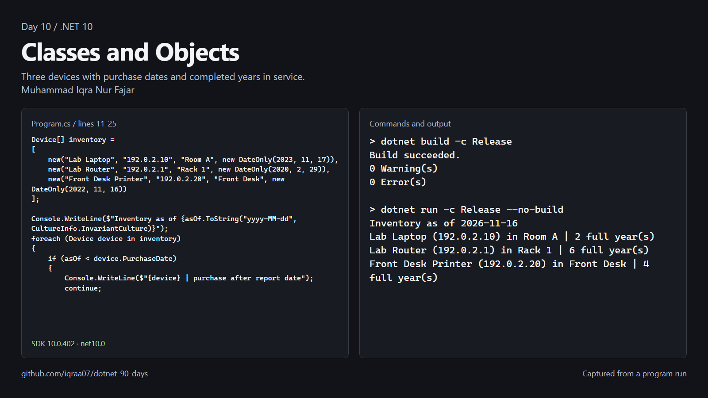

# Day 10: Classes and Objects

Build three inventory objects with a device name, example IP address, location, and purchase date. The implementation is verified and the personal reflection is pending.



[Portrait image](../../assets/progress/day-10-social.png) · [Run transcript](../../assets/progress/day-10-output.txt) · [Checks](../../assets/progress/day-10-checks.txt)

## Run the example

Run this PowerShell command from the repository root.

```powershell
dotnet run --project .\phase-1-csharp\day-10-classes-and-objects -c Release -- 2026-11-16
```

As of `2026-11-16`, the sample devices have `2`, `6`, and `4` completed years in service.

[Exercise documentation](../../phase-1-csharp/day-10-classes-and-objects/README.md) · [Journal](../../journal/day-10-classes-and-objects.md) · [Captured run](../../assets/progress/day-10-capture.json)

[Roadmap](../../ROADMAP.md#day-10--classes-and-objects) · [Day catalog](../README.md)
