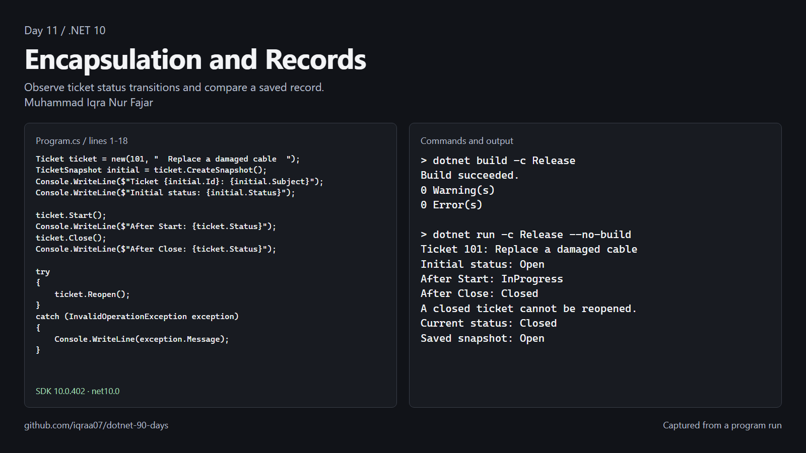

# Day 11: Encapsulation and Records

Use ticket methods to control status changes and keep an earlier record snapshot. The implementation is verified and the personal reflection is pending.



[Portrait image](../../assets/progress/day-11-social.png) · [Run transcript](../../assets/progress/day-11-output.txt) · [Checks](../../assets/progress/day-11-checks.txt)

## Run the example

Run this PowerShell command from the repository root.

```powershell
dotnet run --project .\phase-1-csharp\day-11-encapsulation-and-records -c Release
```

The ticket moves from `Open` to `InProgress` to `Closed`. Reopening raises `InvalidOperationException`, and the saved snapshot still shows `Open`.

[Exercise documentation](../../phase-1-csharp/day-11-encapsulation-and-records/README.md) · [Journal](../../journal/day-11-encapsulation-and-records.md) · [Captured run](../../assets/progress/day-11-capture.json)

[Roadmap](../../ROADMAP.md#day-11--encapsulation-and-records) · [Day catalog](../README.md)
