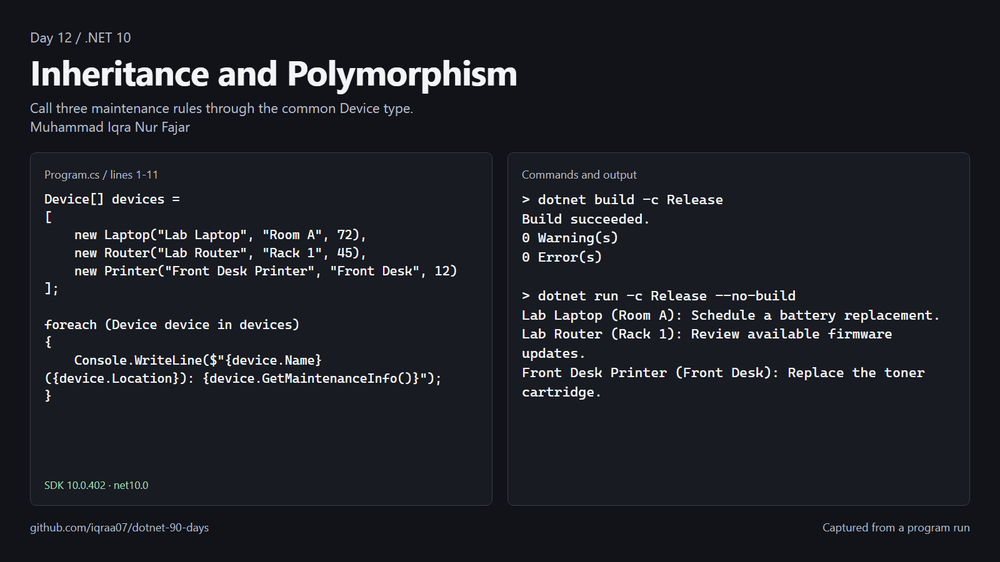

# Day 12: Inheritance and Polymorphism

Call a different maintenance rule for each device through one base class. The implementation is verified and the personal reflection is pending.



[Portrait image](../../assets/progress/day-12-social.png) · [Run transcript](../../assets/progress/day-12-output.txt) · [Checks](../../assets/progress/day-12-checks.txt)

## Run the example

Run this PowerShell command from the repository root.

```powershell
dotnet run --project .\phase-1-csharp\day-12-inheritance-and-polymorphism -c Release
```

The sample recommends replacing the laptop battery, reviewing the router firmware, and replacing the printer toner.

[Exercise documentation](../../phase-1-csharp/day-12-inheritance-and-polymorphism/README.md) · [Journal](../../journal/day-12-inheritance-and-polymorphism.md) · [Captured run](../../assets/progress/day-12-capture.json)

[Roadmap](../../ROADMAP.md#day-12--inheritance-and-polymorphism) · [Day catalog](../README.md)
