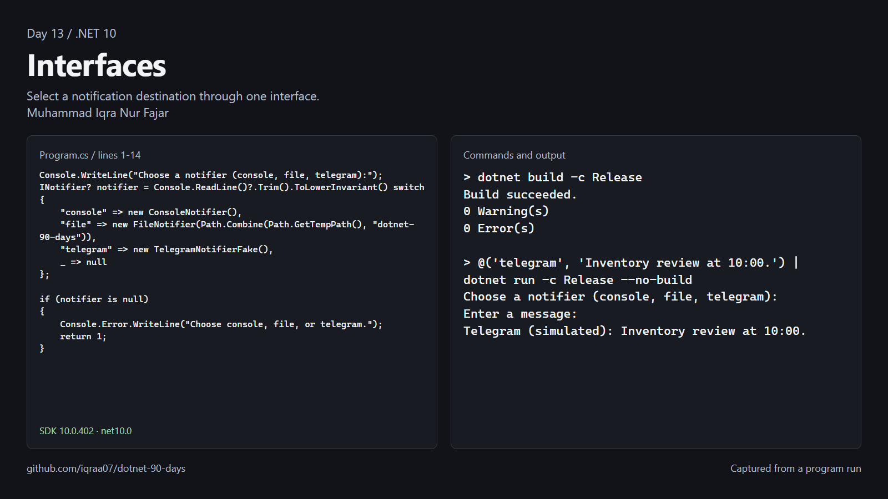

# Day 13: Interfaces

Select a console, file, or simulated Telegram notifier at runtime. The implementation is verified and the personal reflection is pending.



[Portrait image](../../assets/progress/day-13-social.png) · [Run transcript](../../assets/progress/day-13-output.txt) · [Checks](../../assets/progress/day-13-checks.txt)

## Run the example

Run this PowerShell command from the repository root.

```powershell
@('telegram', 'Inventory review at 10:00.') | dotnet run --project .\phase-1-csharp\day-13-interfaces -c Release
```

The sample prints `Telegram (simulated): Inventory review at 10:00.`

[Exercise documentation](../../phase-1-csharp/day-13-interfaces/README.md) · [Journal](../../journal/day-13-interfaces.md) · [Captured run](../../assets/progress/day-13-capture.json)

[Roadmap](../../ROADMAP.md#day-13--interfaces) · [Day catalog](../README.md)
