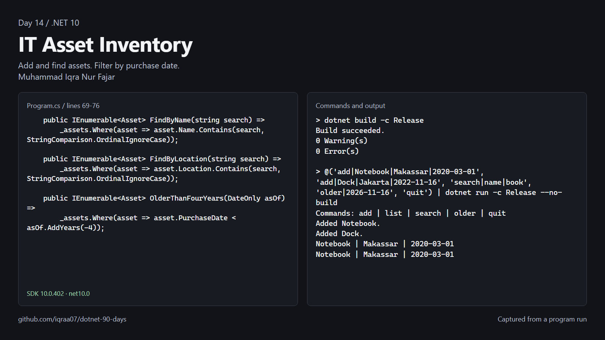

# Day 14: Checkpoint 2: IT Asset Inventory Console

Implementation is complete and verified. Personal reflection is pending in the journal.

Manage IT assets in memory. Add assets, list them, search by name or location, and filter assets more than four years old.



[Portrait image](../../assets/progress/day-14-social.png) · [Run transcript](../../assets/progress/day-14-output.txt) · [CLI checks](../../assets/progress/day-14-checks.txt) · [Capture data](../../assets/progress/day-14-capture.json)

## Run

From the repository root in PowerShell:

```powershell
dotnet build .\phase-1-csharp\day-14-checkpoint-2-it-asset-inventory-console -c Release
@('add|Notebook|Makassar|2020-03-01', 'add|Dock|Jakarta|2022-11-16', 'search|name|book', 'older|2026-11-16', 'quit') | dotnet run --project .\phase-1-csharp\day-14-checkpoint-2-it-asset-inventory-console -c Release --no-build
```

The sample adds a notebook and dock. Name search finds the notebook, and the age filter returns the same asset. The dock was purchased exactly four years before the reporting date.

[Exercise and command reference](../../phase-1-csharp/day-14-checkpoint-2-it-asset-inventory-console/README.md) · [Journal](../../journal/day-14-checkpoint-2-it-asset-inventory-console.md) · [Roadmap](../../ROADMAP.md#day-14--checkpoint-2-it-asset-inventory-console)
