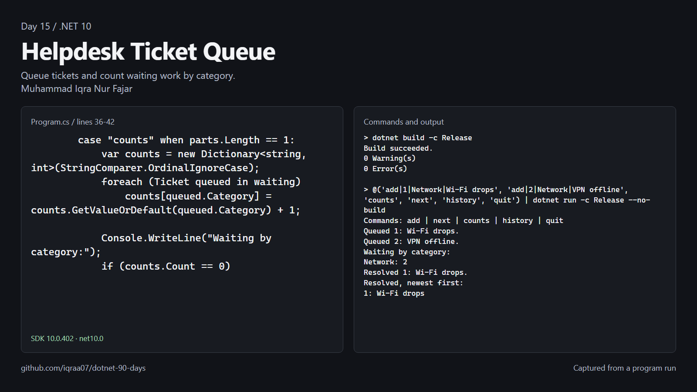

# Day 15: Dictionary, HashSet, Queue, Stack

Implementation is complete and verified. Personal reflection is pending in the journal.

Queue helpdesk tickets in arrival order, count waiting work by category, and list resolved tickets in reverse order.



[Portrait image](../../assets/progress/day-15-social.png) · [Run transcript](../../assets/progress/day-15-output.txt) · [CLI checks](../../assets/progress/day-15-checks.txt) · [Capture data](../../assets/progress/day-15-capture.json)

## Run

From the repository root in PowerShell:

```powershell
dotnet build .\phase-1-csharp\day-15-dictionary-hashset-queue-stack -c Release
@('add|1|Network|Wi-Fi drops', 'add|2|Network|VPN offline', 'counts', 'next', 'history', 'quit') | dotnet run --project .\phase-1-csharp\day-15-dictionary-hashset-queue-stack -c Release --no-build
```

The sample queues two Network tickets, reports `Network: 2`, resolves ticket 1, and lists that ticket in resolution history.

[Exercise and command reference](../../phase-1-csharp/day-15-dictionary-hashset-queue-stack/README.md) · [Journal](../../journal/day-15-dictionary-hashset-queue-stack.md) · [Roadmap](../../ROADMAP.md#day-15--dictionary-hashset-queue-stack)
