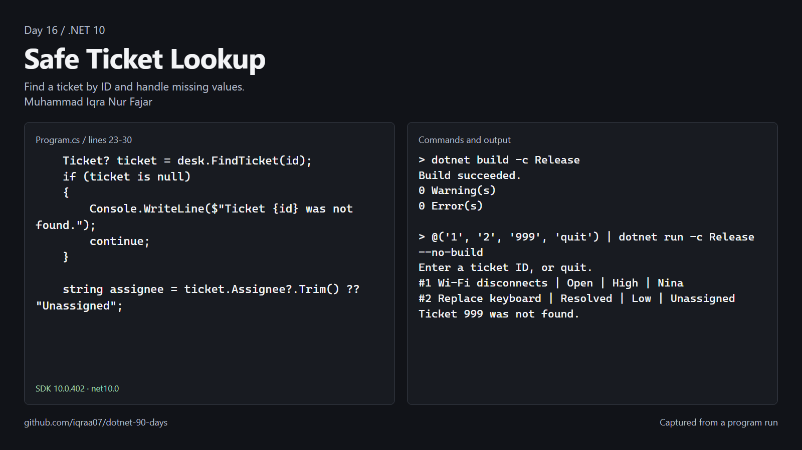

# Day 16: Enums, Structs and Nullable

Implementation is complete and verified. Personal reflection is pending in the journal.

Look up a sample helpdesk ticket by ID using status and priority enums, a value-type key, and a nullable return.



[Portrait image](../../assets/progress/day-16-social.png) · [Run transcript](../../assets/progress/day-16-output.txt) · [CLI checks](../../assets/progress/day-16-checks.txt) · [Capture data](../../assets/progress/day-16-capture.json)

## Run

From the repository root in PowerShell:

```powershell
dotnet build .\phase-1-csharp\day-16-enums-structs-and-nullable -c Release
@('1', '2', '999', 'quit') | dotnet run --project .\phase-1-csharp\day-16-enums-structs-and-nullable -c Release --no-build
```

The sample prints the assigned ticket, shows `Unassigned` for ticket 2, and reports that ticket 999 is missing.

[Exercise and command reference](../../phase-1-csharp/day-16-enums-structs-and-nullable/README.md) · [Journal](../../journal/day-16-enums-structs-and-nullable.md) · [Roadmap](../../ROADMAP.md#day-16--enums-structs-and-nullable)
