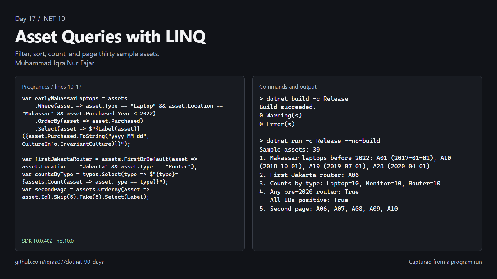

# Day 17: LINQ Part 1

Implementation is complete and verified. Personal reflection is pending in the journal.

Run five LINQ queries against 30 reproducible sample assets.



[Portrait image](../../assets/progress/day-17-social.png) · [Run transcript](../../assets/progress/day-17-output.txt) · [CLI checks](../../assets/progress/day-17-checks.txt) · [Capture data](../../assets/progress/day-17-capture.json)

## Run

From the repository root in PowerShell:

```powershell
dotnet build .\phase-1-csharp\day-17-linq-part-1 -c Release
dotnet run --project .\phase-1-csharp\day-17-linq-part-1 -c Release --no-build
```

The program prints 30 sample assets by count, four matching Makassar laptop IDs in purchase order, the first Jakarta router, type counts, predicate results, and the second page.

[Exercise and command reference](../../phase-1-csharp/day-17-linq-part-1/README.md) · [Journal](../../journal/day-17-linq-part-1.md) · [Roadmap](../../ROADMAP.md#day-17--linq-part-1)
