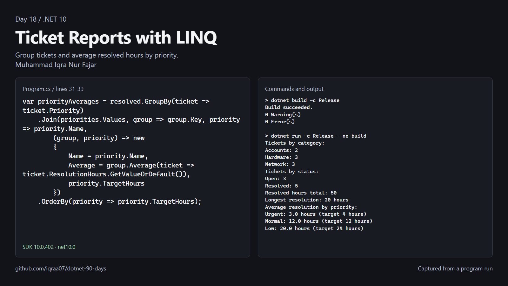

# Day 18: LINQ Part 2

Implementation is complete and verified. Personal reflection is pending in the journal.

Report sample tickets by category and status, then calculate average resolution time by priority.



[Portrait image](../../assets/progress/day-18-social.png) · [Run transcript](../../assets/progress/day-18-output.txt) · [CLI checks](../../assets/progress/day-18-checks.txt) · [Capture data](../../assets/progress/day-18-capture.json)

## Run

From the repository root in PowerShell:

```powershell
dotnet build .\phase-1-csharp\day-18-linq-part-2 -c Release
dotnet run --project .\phase-1-csharp\day-18-linq-part-2 -c Release --no-build
```

The report prints totals by category and status, resolution summary statistics, and an average of 3.0, 12.0, and 20.0 hours for Urgent, Normal, and Low respectively.

[Exercise and command reference](../../phase-1-csharp/day-18-linq-part-2/README.md) · [Journal](../../journal/day-18-linq-part-2.md) · [Roadmap](../../ROADMAP.md#day-18--linq-part-2)
