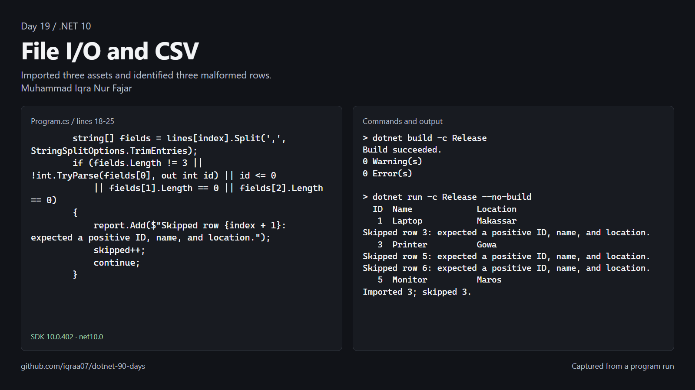

# Day 19: File I/O and CSV

The importer reads a CSV, prints a table of asset IDs, names, and locations, and reports malformed rows by their line number. The implementation is verified. Personal reflection is pending.



[Portrait image](../../assets/progress/day-19-social.png) · [Run transcript](../../assets/progress/day-19-output.txt) · [CLI checks](../../assets/progress/day-19-checks.txt) · [Capture data](../../assets/progress/day-19-capture.json)

## Run the example

From the repository root in PowerShell:

```powershell
dotnet run --project .\phase-1-csharp\day-19-file-i-o-and-csv -c Release
```

The sample imports three assets and skips lines 3, 5, and 6.

[Project notes](../../phase-1-csharp/day-19-file-i-o-and-csv/README.md) · [Learning journal](../../journal/day-19-file-i-o-and-csv.md)

[Full outline](../../ROADMAP.md#day-19--file-io-and-csv) · [Daily progress](../../README.md#daily-progress) · [Day catalog](../README.md)
