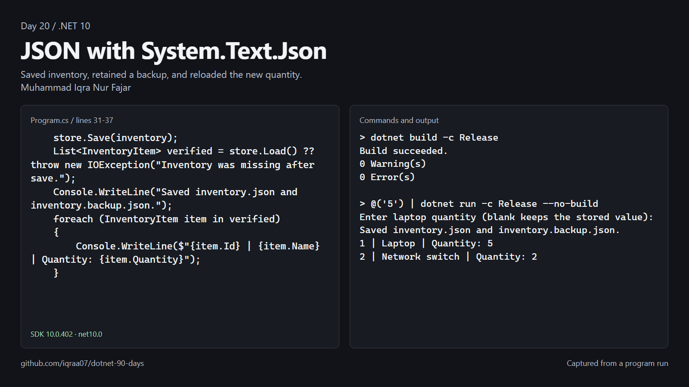

# Day 20: JSON with System.Text.Json

The program saves inventory as JSON, keeps a backup, then reloads the file and prints the stored quantities. The implementation is verified. Personal reflection is pending.



[Portrait image](../../assets/progress/day-20-social.png) · [Run transcript](../../assets/progress/day-20-output.txt) · [CLI checks](../../assets/progress/day-20-checks.txt) · [Capture data](../../assets/progress/day-20-capture.json)

## Run the example

From the repository root in PowerShell:

```powershell
'5' | dotnet run --project .\phase-1-csharp\day-20-json-with-system-text-json -c Release
```

Enter `5` to save and reload a laptop quantity of 5.

[Project notes](../../phase-1-csharp/day-20-json-with-system-text-json/README.md) · [Learning journal](../../journal/day-20-json-with-system-text-json.md)

[Full outline](../../ROADMAP.md#day-20--json-with-systemtextjson) · [Daily progress](../../README.md#daily-progress) · [Day catalog](../README.md)
