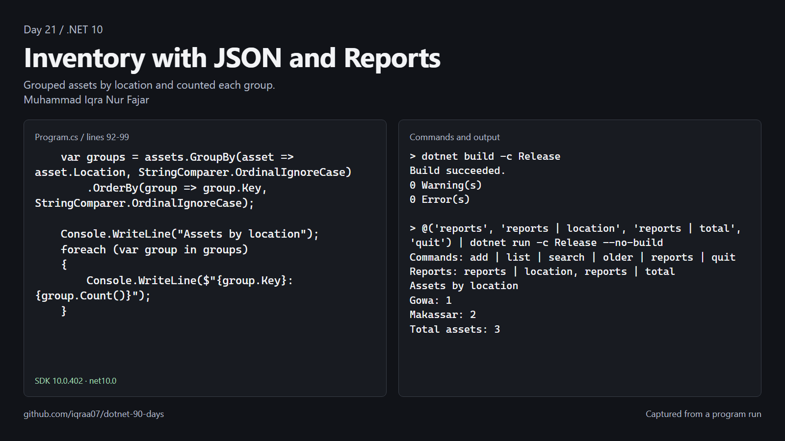

# Day 21: Checkpoint 3: Inventory with JSON and Reports

The inventory console keeps Day 14's add, list, search, and age-filter commands. It saves additions to JSON and reports counts by location. The implementation is verified. Personal and Week 3 reflections are pending.



[Portrait image](../../assets/progress/day-21-social.png) · [Run transcript](../../assets/progress/day-21-output.txt) · [CLI checks](../../assets/progress/day-21-checks.txt) · [Capture data](../../assets/progress/day-21-capture.json)

## Run the example

From the repository root in PowerShell:

```powershell
@('reports', 'reports | location', 'reports | total', 'quit') | dotnet run --project .\phase-1-csharp\day-21-checkpoint-3-inventory-with-json-and -c Release
```

The bundled inventory reports `Gowa: 1`, `Makassar: 2`, and `Total assets: 3`.

[Project notes](../../phase-1-csharp/day-21-checkpoint-3-inventory-with-json-and/README.md) · [Learning journal](../../journal/day-21-checkpoint-3-inventory-with-json-and.md)

[Full outline](../../ROADMAP.md#day-21--checkpoint-3-inventory-with-json-and-reports) · [Daily progress](../../README.md#daily-progress) · [Day catalog](../README.md)
