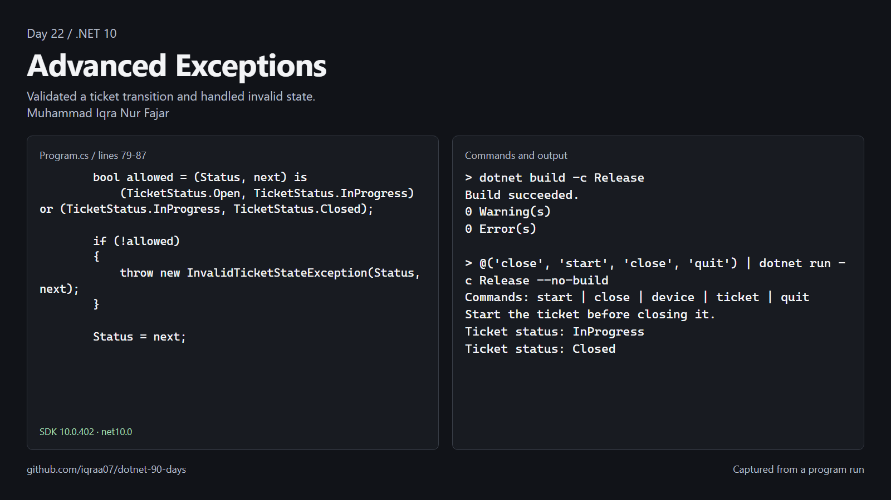

# Day 22: Advanced Exceptions

The ticket class permits `Open → InProgress → Closed`. `InvalidTicketStateException` reports a rejected transition. The device class validates its name and IP address. The implementation is verified. Personal reflection is pending.



[Portrait image](../../assets/progress/day-22-social.png) · [Run transcript](../../assets/progress/day-22-output.txt) · [CLI checks](../../assets/progress/day-22-checks.txt) · [Capture data](../../assets/progress/day-22-capture.json)

## Run the example

From the repository root in PowerShell:

```powershell
@('close', 'start', 'close', 'quit') | dotnet run --project .\phase-1-csharp\day-22-advanced-exceptions -c Release
```

The first `close` prints `Start the ticket before closing it.` The following `start` and `close` move the ticket to `InProgress` and then `Closed`.

[Project notes](../../phase-1-csharp/day-22-advanced-exceptions/README.md) · [Learning journal](../../journal/day-22-advanced-exceptions.md)

[Full outline](../../ROADMAP.md#day-22--advanced-exceptions) · [Daily progress](../../README.md#daily-progress) · [Day catalog](../README.md)
