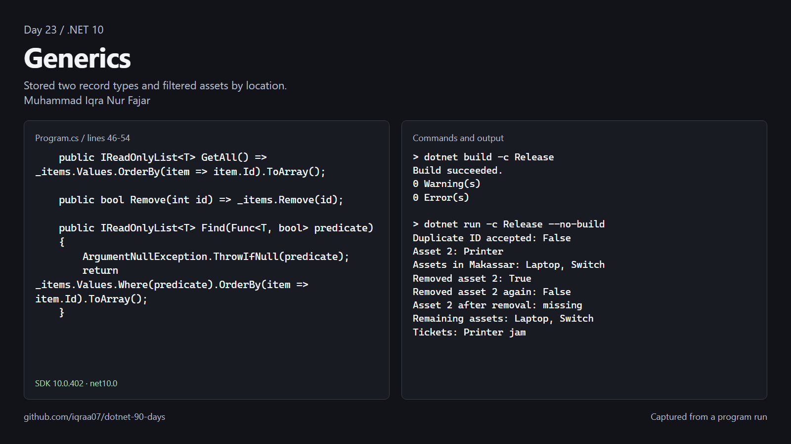

# Day 23: Generics

The in-memory repository stores records by ID and supports adding, lookup, listing, removal, and predicate-based filtering. The example uses the same repository with assets and tickets. The implementation is verified. Personal reflection is pending.



[Portrait image](../../assets/progress/day-23-social.png) · [Run transcript](../../assets/progress/day-23-output.txt) · [CLI checks](../../assets/progress/day-23-checks.txt) · [Capture data](../../assets/progress/day-23-capture.json)

## Run the example

From the repository root in PowerShell:

```powershell
dotnet run --project .\phase-1-csharp\day-23-generics -c Release
```

The location predicate finds `Laptop, Switch`. After removing asset 2, lookup reports it as missing. The ticket repository still lists `Printer jam`.

[Project notes](../../phase-1-csharp/day-23-generics/README.md) · [Learning journal](../../journal/day-23-generics.md)

[Full outline](../../ROADMAP.md#day-23--generics) · [Daily progress](../../README.md#daily-progress) · [Day catalog](../README.md)
