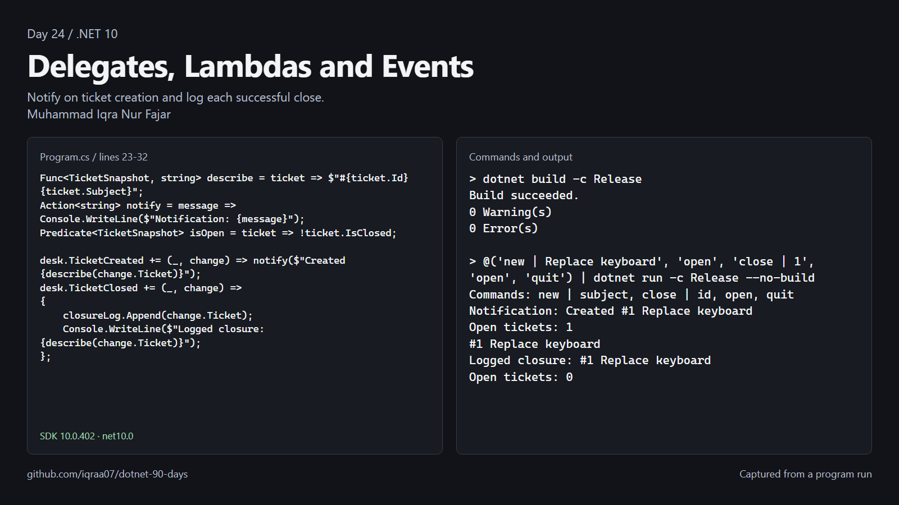

# Day 24: Delegates, Lambdas and Events

The ticket desk raises creation and closure events. A creation subscriber prints a notification, and a closure subscriber appends a JSON Lines record. The Release build passed with 0 warnings and 0 errors. All 13 verification groups passed. Personal reflection is pending.



[Portrait image](../../assets/progress/day-24-social.png) · [Run transcript](../../assets/progress/day-24-output.txt) · [Closure log sample](../../assets/progress/day-24-log.jsonl) · [CLI checks](../../assets/progress/day-24-checks.txt) · [Capture data](../../assets/progress/day-24-capture.json)

## Run the example

From the repository root in PowerShell, create a ticket, inspect the open list, and close the ticket.

```powershell
@('new | Replace keyboard', 'open', 'close | 1', 'open', 'quit') | dotnet run --project .\phase-1-csharp\day-24-delegates-lambdas-and-events -c Release
```

The program prints a creation notification, lists ticket 1, and logs its closure. The final open-ticket count is zero. The log appends a UTC timestamp, ticket ID, and subject. Ticket state lasts for the current process, while the log file persists between runs.

[Delegate examples, event flow, and log commands](../../phase-1-csharp/day-24-delegates-lambdas-and-events/README.md) · [Learning journal](../../journal/day-24-delegates-lambdas-and-events.md)

[Full outline](../../ROADMAP.md#day-24--delegates-lambdas-and-events) · [Daily progress](../../README.md#daily-progress) · [Day catalog](../README.md)
