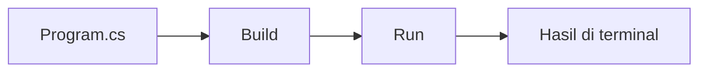

# Day 01: Setup .NET 10 and Hello World

Aplikasi console pertama: menampilkan nama, waktu lokal komputer, dan versi runtime .NET. Kode sudah terverifikasi; refleksi pribadi masih menunggu di jurnal.

[Halaman hari](../../days/day-01/README.md) · [Jurnal](../../journal/day-01-setup-net-10-and-hello-world.md) · [Roadmap](../../ROADMAP.md#day-01--setup-net-10-and-hello-world)

## Alur program



## Kode

```csharp
Console.WriteLine("Muhammad Iqra Nur Fajar");
Console.WriteLine(DateTime.Now);
Console.WriteLine(Environment.Version);
```

1. Baris pertama menampilkan nama sebagai teks.
2. Baris kedua mengambil tanggal dan waktu lokal saat program dijalankan.
3. Baris ketiga menampilkan versi runtime, bukan versi SDK.

Kode memakai top-level statements: perintah dapat ditulis langsung pada `Program.cs`. Pengaturan project ada di `Day01.SetupNet10AndHelloWorld.csproj`, dengan target `net10.0`, Nullable, dan ImplicitUsings aktif.

## Jalankan

Dari root repo, gunakan .NET SDK 10.0.x:

```powershell
dotnet build .\phase-1-csharp\day-01-setup-net-10-and-hello-world -c Release
dotnet run --project .\phase-1-csharp\day-01-setup-net-10-and-hello-world -c Release --no-build
```

Contoh hasil eksekusi:

```text
Muhammad Iqra Nur Fajar
24/10/2026 23:50:29
10.0.13
```

Tanggal berubah setiap program dijalankan dan formatnya mengikuti komputer. Versi runtime dapat berbeda sesuai patch yang terpasang. `dotnet --version` pada lingkungan pengerjaan menampilkan SDK `10.0.402`.

## Verifikasi

Build Release lulus dengan **0 warning dan 0 error**. Program berjalan dengan exit code `0` dan menghasilkan tepat tiga baris. Belum ada project test pada latihan ini.

Project memakai [`UseAppHost=false`](https://learn.microsoft.com/en-us/dotnet/core/project-sdk/msbuild-props#useapphost) agar dijalankan melalui runtime .NET. Pengaturan ini digunakan karena Windows Application Control memblokir executable apphost hasil build pada komputer pengerjaan.

## Langkah berikutnya

Coba jalankan program, lalu isi 3-5 catatan dengan kata-kata sendiri pada bagian `Yang saya pahami` di jurnal. Day 01 tetap berstatus sedang dikerjakan sampai refleksi itu lengkap. Materi berikutnya adalah Variables and Data Types.

## Referensi

- [SDK dan runtime .NET](https://learn.microsoft.com/en-us/dotnet/core/sdk)
- [Top-level statements](https://learn.microsoft.com/en-us/dotnet/csharp/fundamentals/program-structure/top-level-statements)
- [Perintah dotnet run](https://learn.microsoft.com/en-us/dotnet/core/tools/dotnet-run)
