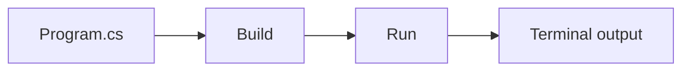

# Day 01: Setup .NET 10 and Hello World

A first console application that prints a name, the computer's local time, and the .NET runtime version. Implementation is complete and verified; personal reflection remains pending in the journal.

[Daily overview](../../days/day-01/README.md) · [Journal](../../journal/day-01-setup-net-10-and-hello-world.md) · [Roadmap](../../ROADMAP.md#day-01--setup-net-10-and-hello-world)

## Program flow



## Source

```csharp
Console.WriteLine("Muhammad Iqra Nur Fajar");
Console.WriteLine(DateTime.Now);
Console.WriteLine(Environment.Version);
```

1. The first line writes the name as text.
2. The second reads the local date and time when the program runs.
3. The third prints the runtime version, which is different from the SDK version.

The program uses top-level statements, so its instructions can appear directly in `Program.cs`. The project file targets `net10.0`, with Nullable and ImplicitUsings enabled.

## Run

From the repository root, with .NET SDK 10.0.x installed:

```powershell
dotnet build .\phase-1-csharp\day-01-setup-net-10-and-hello-world -c Release
dotnet run --project .\phase-1-csharp\day-01-setup-net-10-and-hello-world -c Release --no-build
```

Example output:

```text
Muhammad Iqra Nur Fajar
25/10/2026 04:59:34
10.0.13
```

The timestamp changes on each run, and its format follows the computer's locale. The runtime patch version may also differ. The SDK used for verification is `10.0.402`.

## Verification

Release build passed with **0 warnings and 0 errors**. The program exited with code `0` and printed exactly three lines. This exercise has no test project.

The project sets [`UseAppHost=false`](https://learn.microsoft.com/en-us/dotnet/core/project-sdk/msbuild-props#useapphost) to run through the installed .NET runtime. Windows Application Control blocks the generated apphost executable on the development machine.

## Next steps

Run the program and add your own notes to `What I understood` in the journal. Personal reflection is separate from the completed implementation. Day 02 covers Variables and Data Types.

## References

- [.NET SDK and runtime](https://learn.microsoft.com/en-us/dotnet/core/sdk)
- [Top-level statements](https://learn.microsoft.com/en-us/dotnet/csharp/fundamentals/program-structure/top-level-statements)
- [dotnet run](https://learn.microsoft.com/en-us/dotnet/core/tools/dotnet-run)
