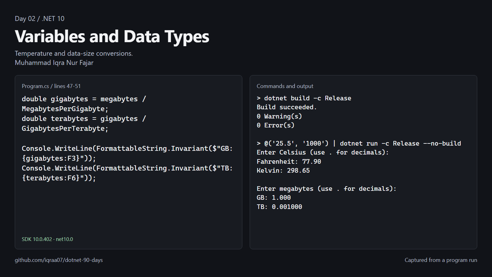
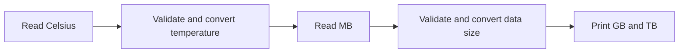

# Day 02: Variables and Data Types

The temperature and data-size converters are implemented and verified. Personal reflection is tracked separately in the [journal](../../journal/day-02-variables-and-data-types.md).



[Portrait image](../../assets/progress/day-02-social.png) · [Captured output](../../assets/progress/day-02-output.txt) · [Verification checks](../../assets/progress/day-02-checks.txt)

## Run

Use .NET SDK 10.0.x. From the repository root:

```powershell
dotnet build .\phase-1-csharp\day-02-variables-and-data-types -c Release
dotnet run --project .\phase-1-csharp\day-02-variables-and-data-types -c Release --no-build
```

Enter Celsius first, then the data size in MB. Use `.` for decimals. For a repeatable sample run in PowerShell:

```powershell
@('25.5', '1000') | dotnet run --project .\phase-1-csharp\day-02-variables-and-data-types -c Release --no-build
```

## Sample output

For Celsius `25.5` and `1000` MB:

```text
Enter Celsius (use . for decimals):
Fahrenheit: 77.90
Kelvin: 298.65

Enter megabytes (use . for decimals):
GB: 1.000
TB: 0.001000
```

## Program flow



Invalid input prints a clear message and stops before the next step. Input errors currently exit with code `0` through a normal return; they do not throw an exception or print a stack trace.

## Conversion rules

| Conversion | Rule | Example |
|---|---|---|
| Celsius to Fahrenheit | Celsius x 1.8 + 32 | `0` becomes `32.00` |
| Celsius to Kelvin | Celsius + 273.15 | `0` becomes `273.15` |
| MB to GB | Divide MB by 1000 | `1000` becomes `1.000` |
| GB to TB | Divide GB by 1000 | `1` becomes `0.001000` |

Data sizes use decimal SI units. This exercise uses MB, GB, and TB rather than the binary MiB, GiB, and TiB units. Zero MB is valid; negative or non-finite data sizes are rejected. Celsius values below `-273.15` and numeric overflow results are rejected as well.

## Concepts

1. Variables keep values available for later calculations; `double` supports fractional measurements.
2. `Console.ReadLine` returns text, while `TryParse` reports whether it can be converted to a number. `Parse` throws for invalid numeric text.
3. `const` gives fixed conversion values clear names.
4. Boolean checks reject non-finite or out-of-range input before results are displayed.
5. Invariant culture makes dot-decimal input predictable; `F2`, `F3`, and `F6` control displayed precision.

| Type or keyword | Use | Example |
|---|---|---|
| `int` | 32-bit whole number | `42` |
| `long` | 64-bit whole number | `3_000_000_000L` |
| `double` | Floating-point measurement | `25.5` |
| `decimal` | Decimal arithmetic | `19.99m` |
| `bool` | True/false value | `true` |
| `char` | Character literal | `'C'` |
| `string` | Text | `"Celsius"` |
| `var` | Infer a local variable's type | `var attempts = 3;` |
| `const` | Compile-time constant | `const int MaxAttempts = 3;` |

## Verification

Release build passed with **0 warnings and 0 errors**. All **26 CLI checks** passed, covering valid temperature conversions, invalid Celsius, zero and fractional data sizes, decimal-unit conversions, non-finite values, comma decimals, empty input, and EOF at either prompt.

The [check transcript](../../assets/progress/day-02-checks.txt) records the actual inputs, stdout, stderr, and exit codes. The images arrange a source excerpt and output from a real sample run; the full captured source and supplied input are retained in the capture data.

There are no remaining implementation TODOs. Add your own notes under `What I understood` in the journal when ready. Day 03 is the next planned exercise.

## References

- [Double.TryParse](https://learn.microsoft.com/en-us/dotnet/api/system.double.tryparse?view=net-10.0)
- [Double.IsFinite](https://learn.microsoft.com/en-us/dotnet/api/system.double.isfinite?view=net-10.0)
