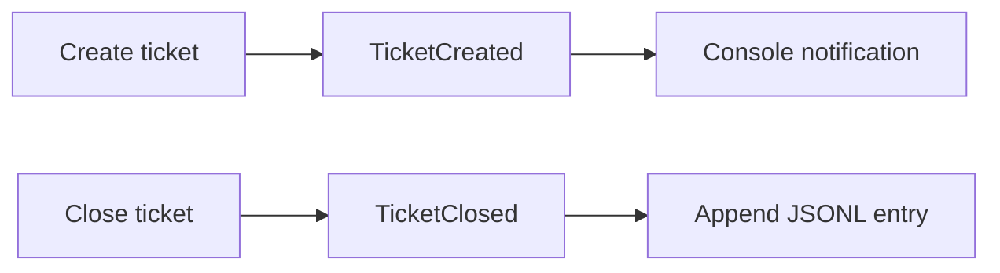

# Day 24: Delegates, Lambdas and Events

Create a helpdesk ticket, notify a subscriber, and append a JSON Lines entry when the ticket closes. The exercise connects delegates and lambdas to the `TicketCreated` and `TicketClosed` events.

## Run the example

From the repository root in PowerShell, build the project and send it the sample commands.

```powershell
dotnet build .\phase-1-csharp\day-24-delegates-lambdas-and-events -c Release
@('new | Replace keyboard', 'open', 'close | 1', 'open', 'quit') | dotnet run --project .\phase-1-csharp\day-24-delegates-lambdas-and-events -c Release --no-build
```

```text
Commands: new | subject, close | id, open, quit
Notification: Created #1 Replace keyboard
Open tickets: 1
#1 Replace keyboard
Logged closure: #1 Replace keyboard
Open tickets: 0
```

## Commands and data

Use `new | subject` to create a ticket, `open` to list open tickets, `close | id` to close one, and `quit` to exit. Commands ignore case and surrounding whitespace. An invalid command reports the expected format and lets you try again. End-of-input also exits successfully.

The application keeps tickets in memory. Each new process starts its IDs at 1. Closing a missing or already closed ticket displays a message. A repeated close leaves the event log with its original entry.

## Delegates and event flow

`Func<TicketSnapshot, string>` formats a ticket label. `Action<string>` sends that label to the console notification. `Predicate<TicketSnapshot>` describes an open ticket for `Find`. The lambdas provide each delegate's behavior.

`TicketDesk` exposes `EventHandler<TicketEventArgs>` events. Each event carries an immutable `TicketSnapshot`, and the subscribers handle creation and closure independently.



The events run synchronously after the desk updates its state. If the closure-log write fails, the program reports that the ticket is closed and exits with code 1. It prints `Logged closure` only after the append succeeds.

## Read the closure log

The default log is `data/ticket-events.jsonl` beside the built application. After the Release run above, read each JSON line from the repository root.

```powershell
Get-Content .\phase-1-csharp\day-24-delegates-lambdas-and-events\bin\Release\net10.0\data\ticket-events.jsonl | ForEach-Object { $_ | ConvertFrom-Json }
```

Each entry contains `ticketId`, `subject`, and a UTC `closedAt` timestamp. Runs append to the existing file. The default path is inside ignored build output. To select a different log, pass one positional path after `--`.

```powershell
dotnet run --project .\phase-1-csharp\day-24-delegates-lambdas-and-events -c Release --no-build -- (Join-Path $env:TEMP 'day-24-ticket-events.jsonl')
```

The Release build passed with 0 warnings and 0 errors. All 13 verification groups passed, covering the CLI, log append behavior, event payloads, and delegates.

[Captured closure-log entry](../../assets/progress/day-24-log.jsonl) · [CLI checks](../../assets/progress/day-24-checks.txt)

[Daily overview and evidence](../../days/day-24/README.md) · [Learning journal](../../journal/day-24-delegates-lambdas-and-events.md)
